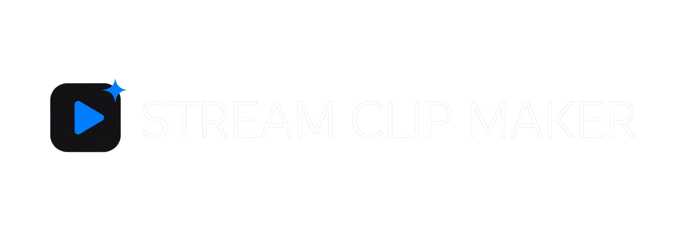

<div align="center">
  
</div>

# Stream Clip Maker

**Encuentra los mejores momentos de directos de Twitch y YouTube a partir de las reacciones del chat y conviértelos en clips.**

Stream Clip Maker analiza la actividad del chat para detectar momentos en los que reaccionan muchas personas distintas a la vez. Ordena los momentos destacados y puede generar los comandos de corte o ejecutar el flujo con FFmpeg, yt-dlp o TwitchDownloaderCLI.

- Detecta momentos destacados en chats JSON de TwitchDownloader y replay JSONL de YouTube.
- Puntúa picos de reacción según usuarios únicos, mensajes de reacción y una línea base móvil.
- Crea clips desde VODs de Twitch, URLs de YouTube o grabaciones locales.
- Exporta versiones verticales 9:16 con fondo desenfocado.
- Incluye herramientas opcionales para Android/Termux con subtítulos en español y título incrustado.

**No necesita dependencias Node.js de terceros.** Para descargar y renderizar vídeo hacen falta herramientas externas.

English: [README.md](README.md)

## Instalación

Necesitas Node.js 18 o superior.

```bash
npm install --global stream-clip-maker
```

O ejecútalo sin instalación global:

```bash
npx stream-clip-maker --help
```

## Inicio rápido

Descarga primero el chat del directo:

```bash
# Chat de Twitch
TwitchDownloaderCLI chatdownload --id <ID_DEL_VOD> -o chat.json

# Replay del chat de YouTube
yt-dlp --skip-download --write-subs --sub-langs live_chat -o directo "<URL_YOUTUBE>"
```

Analiza el chat y muestra los comandos sugeridos:

```bash
stream-clip-maker chat.json --vod <ID_DEL_VOD> --vertical
stream-clip-maker directo.live_chat.json --url "<URL_YOUTUBE>" --vertical
```

Ejecuta los comandos y crea los clips:

```bash
stream-clip-maker chat.json --vod <ID_DEL_VOD> --vertical --run --out clips
stream-clip-maker directo.live_chat.json --url "<URL_YOUTUBE>" --vertical --run --out clips
stream-clip-maker chat.json --video grabacion.mp4 --vertical --run --out clips
```

Todas las opciones:

```bash
stream-clip-maker --help
```

## Requisitos

- Node.js 18 o superior.
- FFmpeg para cortar y renderizar vídeo.
- Descargas de VODs de Twitch: [TwitchDownloaderCLI](https://github.com/lay295/TwitchDownloader).
- Descargas de YouTube: [yt-dlp](https://github.com/yt-dlp/yt-dlp).
- Flujo opcional en Android/Termux: Whisper.cpp y su modelo multilingüe base para generar subtítulos.

El análisis del chat no tiene dependencias Node.js de terceros. Para descargar y renderizar medios hacen falta las herramientas externas correspondientes.

## Cómo detecta los momentos destacados

- Divide el chat en ventanas de 10 segundos.
- Puntúa cada ventana según el número de usuarios únicos y la proporción de ellos que envían reacciones.
- Reduce el peso de ventanas dominadas por mensajes repetidos que parecen encuestas.
- Detecta candidatos cuando superan la línea base y el mínimo de personas que reaccionan.
- Une picos cercanos en un clip, hasta la duración máxima configurada.
- Por defecto ignora los tres primeros minutos para evitar picos de saludos.

La puntuación es heurística, no un modelo de inteligencia artificial. El chat puede reaccionar a lo que dice o hace el streamer, no solo al juego. Revisa siempre los momentos y los vídeos finales.

## Clips verticales

La opción `--vertical` crea una versión 9:16 con fondo desenfocado. Actualmente no incluye seguimiento automático de caras ni reencuadre inteligente del sujeto.

## Herramientas Android / Termux

El repositorio también incluye scripts opcionales para Android:

- `make-clips.sh`: descarga el chat de un VOD de Twitch, detecta momentos, crea clips verticales, añade subtítulos en español y título, y copia los resultados a Descargas.
- `enhance-clip.sh`: transcribe voz en español con Whisper.cpp e incrusta título y subtítulos.
- `discover-twitch.sh`: busca directos por categoría usando Twitch Helix.
- `youtube-auth.mjs` y `youtube-upload.mjs`: autorización local OAuth y subida privada a YouTube.
- `publish-short.sh`: valida un MP4 final 1080×1920 de hasta 180 segundos antes de subirlo.

Estos scripts están diseñados para el entorno Termux del proyecto y requieren herramientas y configuración locales adicionales. No es un servicio alojado y no publica automáticamente.

### Configurar la búsqueda de Twitch

1. Crea una aplicación en [Twitch Developer Console](https://dev.twitch.tv/console/apps).
2. Copia `.env.example` a `.env` y completa `TWITCH_CLIENT_ID` y `TWITCH_CLIENT_SECRET`.
3. Añade en `allowedCreators` de `rules.json` los nombres de creadores cuyo contenido tienes permiso para editar.
4. Ejecuta `./discover-twitch.sh "GTA 6"` desde una copia del repositorio.

Los canales encontrados **no quedan autorizados automáticamente**. Solo los creadores incluidos expresamente en `allowedCreators` aparecen como autorizados. Encontrar un directo mediante la API de Twitch no concede permiso para reutilizar su contenido.

### Seguridad al subir a YouTube

El uploader exige la opción explícita `--confirm-rights`, solo acepta archivos terminados en `_final.mp4`, comprueba la resolución 1080×1920 y la duración máxima de 180 segundos, y sube los vídeos como privados. Revisa el clip, los permisos del creador, el título y la descripción antes de publicar.

## Desarrollo

```bash
npm run check
npm test
npm pack --dry-run
```

## Licencia

MIT. Consulta [LICENSE](LICENSE).
